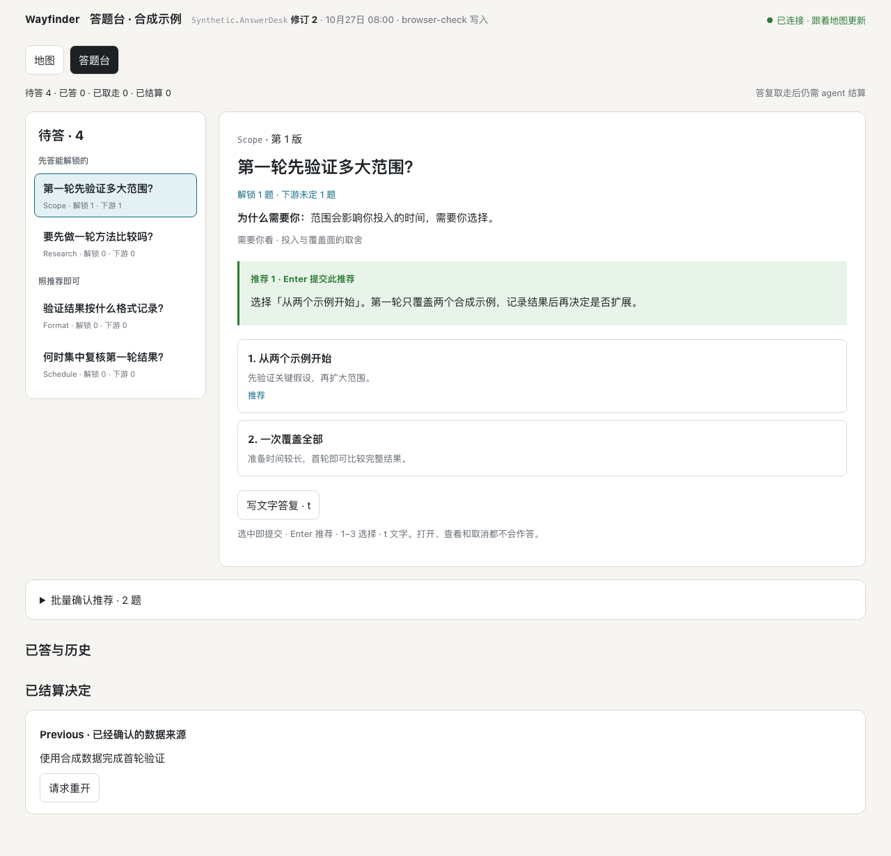
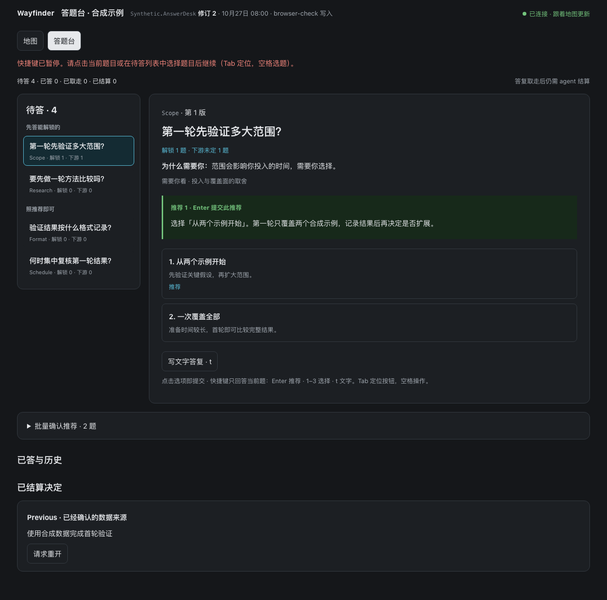
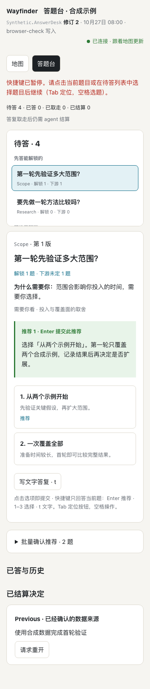

# Answer Desk viewer (#113)

This slice implements [Answer Desk §5, §7 and §9](../spec/answer-desk.md) on the existing Map viewer. It ships as Release Version 3.3.0 **disabled by default**, using the same `answerDeskEnabled` setting introduced by the storage slice. It changes no MCP tool or workflow text. Delivery transport and coordinated real-client/ChatGPT acceptance remain separate work.

## Browser boundary

`POST /api/desk` is the only browser write route. Its JSON body contains `mapId` and one of:

- `action: "answer", submissions: [{questionId, questionVersion, choice: {option} | {text}}]` for a single answer or replacement. Multiple submissions are admitted only for pending `followRecommendation` questions and their displayed recommended option; storage commits them atomically.
- `action: "reopen", submission: {ticketId, settlementIntroducedAtRevision, affectedTickets, affectedSettlementRevisions, requested}` to file or replace a Reopen Request.
- `action: "cancelReopen", requestId` to cancel a pending request.

The host first enforces the exact loopback Host. The route requires exact same-origin `Origin`, rejects foreign `Sec-Fetch-Site`, accepts JSON up to 1 MiB and checks `X-Wayfinder-Key` against a constant-time SHA-256 comparison. It accepts no query, MCP credential, Map command, taking operation or Settlement. It returns fixed errors and no diagnostic text. Responses retain no-store, no-referrer, same-origin resource policy and the viewer CSP. The ChatGPT relay remains unchanged and forwards only `/mcp`.

With the setting absent or false, `/api/desk` returns 404 for every method, `/viewer/desk.js` is unavailable, view responses omit `desk`, the page has no Answer Desk UI (including an already-open page after a disabled restart at the same Revision), and revision polling still returns 204 when unchanged. Every other viewer route remains GET/HEAD. With the setting on, reads remain unkeyed; keyless pages can inspect desk state but have no enabled response controls.

## Key issuance and handoff

`createViewerKey` generates 32 independent random bytes per enabled service process. Nothing derives it from the MCP token or stores it in a Map. `LocalServiceConfiguration.answerDeskKeyPath`, exposed as the operator-only `WAYFINDER_ANSWER_DESK_KEY_FILE`, optionally publishes it after listener startup. The file's parent must already be a current-user private directory; the destination must be absent or a private regular file. Publication uses an exclusive temporary 0600 file and atomic rename, refusing symlinks. Startup failures print only existing fixed operator errors. Normal stop removes the matching file, and every restart creates a different key even after a crash.

The launcher sets that file path to `answer-desk-key` in its private service directory. `wayfinder desk <mapId>` verifies its ownership/type/mode, checks the enabled read projection, then opens `http://127.0.0.1:<port>/maps/<mapId>#key=…` in the macOS default browser. It sends `open location` over a pipe to the fixed `/usr/bin/osascript -` executable, which dispatches an Apple event. The key is in stdin only, never argv or environment; the child receives only a fixed `PATH`, both diagnostic streams are discarded, and the launch times out after 30 seconds. `BROWSER` is deliberately ignored. Unsupported platforms fail with a fixed error and have no generic-browser fallback. This retains the specified fragment handoff without adding another HTTP capability or bootstrap endpoint.

The command neither enables the feature nor prints the URL or adds a launch-metadata record. The launcher regression uses a real executable that records its argv/environment as `BROWSER`: an unkeyed probe proves the recorder works, then the desk launch must leave its keyless output untouched. A second real subprocess stands in for the OS Apple-event endpoint, verifies the exact production argv/environment and captures the URL only from stdin. It attempts to echo that stdin to stdout/stderr on both success and failure; neither stream reaches the launcher output. No real browser, harness or service is opened by this test.

The viewer reads the fragment before its first data request, strips it with `history.replaceState(null, …)` and retains the key only in closures. It is not in DOM attributes, history state, cookies, browser storage, global variables, returned data, scripts or service logs. Refreshing or opening another page requires the launcher again. A service restart rejects an existing page's old key; the UI reports that it must be reopened. Same-user private-file access is an operator capability, not an MCP privilege: an unrestricted same-user process can still read the private key file. Fragment stripping does not promise erasure from the browser's own history database; restart invalidates any retained old key.

## Projection and interaction

When enabled, the existing `/api/maps/<mapId>/view?known=<revision>` returns a fresh coherent head/desk projection every two seconds, even when the Revision is unchanged. The page avoids repainting unchanged desk content, and preserves a text modal and draft across both desk changes and new Map Revisions. It retains the viewer's unreachable/stale indication. Human writes call the existing guarded storage seam and never advance a Map Revision.

The queue uses the service's order without recomputing it: unlock/research gates, Unlock Count, Downstream Count, triage, time and identity. Each question shows consequences, why Kun is needed, triage reason, full recommendation and two or three options. Selection submits immediately; with focus outside interactive controls, Enter submits the explicitly labelled recommendation, 1–3 select and `t` opens a text draft. Focused buttons, inputs, links and other interactive controls retain their native keyboard actions: queue Enter selects that question, option Enter submits that option, and text-button Enter opens its draft. Empty text, viewing, opening and cancelling submit nothing. Bulk confirmation shows every selected full recommended answer in a modal; it captures the displayed Question Versions and does not silently rebind them after a poll.

If polling finds that the Question Version being viewed has been withdrawn, replaced or settled, the card retains its old identity and question with “问题已变，请重新选择题目后再回答。” The pause disables writes and shortcuts across subsequent polls, including an empty queue followed by new questions. Kun must explicitly select a queue question or an editable answer, or activate “已了解，查看当前题目”, before responding again. That acknowledgement also releases the pause when no live question remains, so settled-history actions remain reachable. Successful human submissions still advance to the next pending question normally; a background publication change cannot authorize that navigation.

Answered and Taken answers remain editable until Settlement. Withdrawal strikes through the question and displays its reason. Old answers and superseded publications appear as history. Requested-option markers remain visually separate from submitted answers and recommendations; text Reopen context is displayed verbatim with no prefilled answer. The browser test checks that a marker for option 2 still makes Enter submit recommendation 1.

Every settled Ticket, including a conversation-only Settlement, offers a Reopen Request. The modal captures the target and dependent Settlement identities and displays the full affected list before filing. The storage transaction verifies the entire binding set. If it changes, filing is refused and the modal requires explicit review of the new list; nothing is filed or replaced. Conversation-only Settlements offer text only. Pending requests can be cancelled; Taken requests can only be replaced after another review. The page never reopens or settles a Ticket itself, retries an unknown receipt or treats a Quiet Window as automatic Settlement.

## Evidence

Only disposable SQLite fixtures and synthetic text were used. No real model/client, real database, everyday service, tunnel, port 18765/18766 or `npm run serv` was used.

- `tests/viewer-desk.test.ts`: absent/false setting, route/method/Host/origin/key boundaries, bounded and malformed bodies (including complete 413 responses for fixed-length and chunked excess uploads), no token substitution or general edits, bulk admission, unchanged Revisions, desk-only polling, answer replacement and stale-publication rejection, Reopen binding changes/cancellation/replacement, restart rotation, private-file refusal and the subprocess launcher handoff above.
- Existing `tests/viewer-http.test.ts` continues to cover the disabled read-only viewer and access behavior.
- `tests/helpers/viewer-desk-browser.mjs` uses headless Chromium and a fresh cache database. It verifies real Tab traversal followed by Enter on queue/text/option buttons; numeric/text keys while a button is focused; no writes before deliberate reselection after replacement, withdrawal, empty-queue/new-publication and Settlement; normal body shortcuts and post-submit advancement; keyboard/text/bulk/edit behavior; empty/cancel/open no-ops; draft preservation; Taken/Settled following; withdrawal history; stale editor refusal; affected-list re-review; cancellation; preselection/text context; fragment/storage/DOM absence; restart invalidation and disabled UI. A controlled clock advances release boundaries without timing races. It produces the screenshots below and checks 375px without horizontal overflow. No browser dependency was added to the project.

To reproduce after `npm run build`, set `WAYFINDER_PLAYWRIGHT_MODULE` to the absolute `playwright/index.mjs` of a local Playwright installation, then run `node tests/helpers/viewer-desk-browser.mjs` under Node 26.3.0. Set optional `WAYFINDER_BROWSER_EVIDENCE_DIR` to keep repeat-run screenshots outside the checked-in evidence directory. The helper owns and removes only its new `~/Library/Caches/wayfinder-behaviour-tests/answer-desk-browser-*` directory and its free-port service.

| Light | Dark | 375px |
| --- | --- | --- |
|  |  |  |

Final build/test/typecheck results are recorded in the PR. The parallel delivery slice can overlap `src/mcp-http-internal.ts` (configuration, viewer dispatch, startup/stop) and the version/CHANGELOG files; it does not require changing this slice's browser route or tools/workflow. Merge order must assign a fresh minor Release Version and tag after merge.

Review round 2, 2026-10-27: Node 26.3.0 `npm run build`, `npm run typecheck`, `npm test` (54 files / 2,335 tests, 200.22 seconds), `git diff --check` and the expanded Chromium helper all passed. The initial targeted HTTP run reproduced an `ECONNRESET` on the excess-body boundary; after draining excess uploads, both fixed-length and chunked refusal checks passed in the targeted run and full suite. Version 3.3.0 remains pending the coordinator's merge-order decision.
