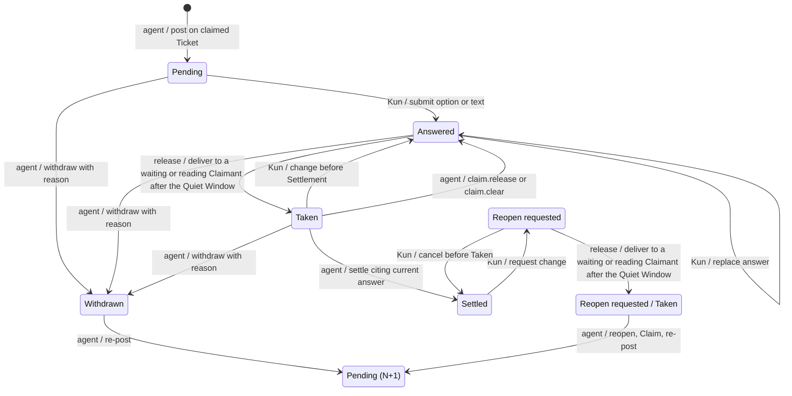

# Answer Desk

Status: accepted by Kun on 2026-10-26 for [#109](https://github.com/kun-g/wayfinder_map_service/issues/109), part of [#108](https://github.com/kun-g/wayfinder_map_service/issues/108). The design session checks the transcription before the coordinator closes #109 and #110–#114 start. This describes the implementation contract, not a delivered capability.

The design session's defaults, including the review clarifications on storage, citations, affected dependents and public schemas, were accepted by Kun on 2026-10-26 and relayed through the implementation coordinator. This document is their single normative source; the viewer/MCP amendments and ADRs link here. Use [GLOSSARY.md](../../GLOSSARY.md), [M1](m1.md), [the local MCP contract](mcp-sqlite.md) and [the viewer contract](map-viewer.md) for unchanged behavior.

## 1. Outcome and boundary

Agents post every currently askable question to the Answer Desk on the local Map viewer and continue independent work. Kun considers them at his own pace; the service delivers his responses, and the agent settles the Decision Tickets.

The desk belongs to the existing Wayfinder service. Its target business interface is exactly `map_create`, `map_list`, `map_read`, `map_apply` and `map_wait`, with one keyed browser write entry for human responses. Map edits, question posting/withdrawal, Claims, reopening and Settlements remain MCP operations. Agents cannot submit or confirm Desk Answers through MCP. There is no embedded assistant, separate answer service, general graph editor, public listener, OAuth, sharing or MCP Apps delivery.

The Ticket's question remains only the question; recommendations live on the Desk Question and the accepted outcome lives in the Settlement. Desk delivery states neither replace the Ticket's open/settled lifecycle nor affect Frontier membership. An answer is not a Decision, Finding or Completion merely because it was submitted or Taken.

The two client spikes in #108 support the transport choice, not feature acceptance: Claude Code 2.1.310 resumed an idle session after a server-everything 2.0.1 HTTP task completed two minutes later; Codex 0.164.0 negotiated `2025-11-25` and completed a 90-second blocking call with `tool_timeout_sec = 300`. The decisions and alternatives are recorded in [ADR 0006](../adr/0006-answer-desk-in-the-map-viewer.md) and [ADR 0007](../adr/0007-map-wait-for-answer-delivery.md).

## 2. Questions and answers

Accepted fields:

| Desk Question field | Meaning |
| --- | --- |
| `questionId`, `ticketId`, `questionVersion` | Identify the request, its Decision Ticket within its Map and the exact published Question Version, distinct from a Map Revision or Release Version. |
| Options | Two or three choices, each with a label and one-line description; keyboard choices correspond to 1–3. |
| Recommended option and full recommended answer | Identify the recommendation and show the complete proposed answer on which Kun can give a verdict. |
| `whyKun` | Explain why this question needs Kun's judgment. |
| `triage`, with reason | `needsKun` or `followRecommendation`, with the agent's explanation of the classification. Both still require a human answer. |
| `gatesResearch` | Whether this answer decides if long research should be dispatched. |
| `postedAt` | Publication time used after the dependency and triage ordering keys. |

The view shows what the question unlocks from the current Dependencies, including both computed counts in section 5. Agents supply the triage reason and research flag; they do not store or invent unlock counts.

There is at most one active Desk Question per Decision Ticket. An agent posts it through `map_apply` only on a Ticket it claims, under the existing `expectedRevision` and Claim rules. Any change to its options, recommendation or meaning, including a typo correction, requires withdrawal with a reason followed by publication of version N+1. There are no in-place edits. An old publication and its answers remain inspectable; re-posting does not repurpose their identity.

A Desk Answer records its own identity, the Question Version it answers and the selected option or non-empty text. A changed answer supersedes the prior answer; retain both and identify the current one. Answers to older Question Versions are marked stale and are never released or settled. A submission for a question withdrawn since it was displayed is refused with “question changed, answer again”; never silently apply it to N+1.

## 3. State and transition ownership

Taken belongs to a Desk Answer or Reopen Request as its delivery state; a Desk Question's displayed state derives from its publication, current answer and Ticket Settlement. The diagram shows that display and a request's delivery marker, not extra Ticket lifecycle states. `Pending (N+1)` is a new publication, not erasure of the previous one. Each edge has one owner: Kun, the agent, or the release coordinator shared by `map_wait` and taking `map_read`.



Changing a Taken answer before Settlement immediately voids the old answer and leaves the replacement Answered. A withdrawal has a nonblank reason; the viewer strikes through the question and shows that reason.

### Claim release and inheritance

Pending and Answered questions belong to the Ticket and remain when its Claim is released or cleared. The next Claimant inherits them and may withdraw/re-post. If an answer is Taken but unsettled, the agent's `claim.release` or `claim.clear` command returns it to Answered in the same transaction as that command's Revision. Disconnection alone does not release a Claim.

### Reopen Requests

When Kun files a Reopen Request, the desk shows the settled dependent Tickets that the service computes M1 would require reopening, and the request records that exact list as `affectedTickets`, along with the requested option or text. Filing is Kun's agreement to reopen the target and exactly those named dependents, applying the existing human-verdict rule at request time. It is not a verdict on a replacement answer. Kun may cancel after seeing the list until the request is Taken; the Ticket stays settled until explicit agent action and there is no agent rejection state.

The first Claimant taking answers on the Map receives the request as a `reopen_request` item. A settled Ticket has no Claim and the original agent session may be gone, so requests are Map-scoped. Taking is once-only, but current reads also list Taken-but-unhandled requests for recovery; any Claimant on the Map may handle one without releasing it again.

The agent reopens the target and exactly the recorded affected set in one batch, under M1's existing reopen/Claim rules. `map_apply` gains optional `reopenRequestId` to cite the request that this batch handles; the service marks it handled when that batch commits, after which it leaves the recovery list. If the required set has grown, the agent does not reopen the extras and first asks Kun, naming them; it cannot use the old request to authorize a larger set. There is no silent cascade. After reopening, the agent claims and re-posts as N+1, with the desk preselecting the requested option without submitting it. Kun must confirm the new publication before another Settlement, even if he chooses the original answer.

## 4. Submission, release and Settlement

### Human submission

Selection submits immediately. Enter submits the recommendation, 1–3 submit the corresponding option, and `t` opens text entry. Opening, viewing and cancelling never submit; empty text never submits. Bulk confirmation applies only to selected `followRecommendation` questions and shows each full recommended answer before confirmation. It creates a separate answer to each displayed Question Version. A blanket “use recommendations” outside the desk remains insufficient.

One Quiet Window belongs to the Map, across questions and Claimants. Each successful new or changed submission restarts 15 seconds from the latest submission; a failed submission is not an answer. Editing several answers during that interval produces a batch containing only their latest valid versions. The service owns this timing; closing the page does not constitute either a verdict or a release. Expiry makes answers eligible for delivery, never for automatic Settlement.

### Agent delivery

The shared release coordinator delivers eligible answers only for the caller's currently claimed Tickets, plus Map-scoped Reopen Requests under section 3. All eligible items for that caller are delivered in one batch after the Map is quiet. Competing waiters cannot both take an item; only the explicit Claim-return transition above makes a previously Taken answer eligible again.

Commit Taken durably in an atomic release transaction just before writing a blocking or taking-read response, or before the first `tasks/get` that returns completed. An uncollected task does not take answers merely because the Quiet Window ended. Recheck the current answer, Question Version and applicable Claim at delivery, including when a task result was prepared earlier. If the task's recheck finds nothing left, its completed result is `none_yet`. A network failure after the commit leaves the receipt unknown; writing a response is not proof that the client received it.

Taken survives disconnects, timeouts, cancellation and restarts. Current reads expose Taken-but-unsettled answers for recovery; neither a missing receipt nor a new wait auto-returns or settles them. Reopen Request recovery follows section 3. A rejected stale Settlement must not consume the replacement answer.

### Agent Settlement

The `ticket.settle` command gains this additive, optional typed field alongside its existing fields:

```ts
deskAnswer?: { answerId: string; questionVersion: number };
```

It is mandatory when the Ticket has an active Desk Question. The citation must identify the current answer to the current Question Version, Taken by the settling Claimant; otherwise the service rejects the Settlement, including an answer never Taken. This is an explicit command field, not a custom Provenance field, Reference locator or Extensions convention. Retain the accepted citation with the Settlement record; M1's typed outcome, Evidence and Provenance remain unchanged. Validation and publication must prevent a concurrent answer change from producing an accepted stale Settlement.

Every displayed option is a proposed answer: its label and one-line description are what Kun saw and what the Settlement records. Selecting option 2 can therefore settle directly under the same checks as the recommendation; it needs no second question. Text is never auto-settled: the agent distinguishes a verdict on a displayed answer from a request for material. For the latter it withdraws with a reason, supplies the material and posts a new version. The Ticket's question remains unchanged, and no timer, task completion or lack of response settles anything.

For a conversation verdict while the Desk Question is Pending or Answered, the agent withdraws it in the same batch with reason `answered in conversation` and then settles without `deskAnswer`. A valid desk-backed Settlement closes its active question; any Settlement that would leave a question active is rejected. The agent cannot bypass the citation check by omitting it on an active question.

## 5. Queue ordering

The service derives ordering from the current Map; this display order does not change the M1 Frontier's ASCII Ticket-ID order. Compare these keys lexicographically:

1. Unlockers first: `immediateUnlocks > 0` **or** `gatesResearch` is true.
2. `immediateUnlocks` descending, then `downstreamUnsettled` descending.
3. `needsKun` before `followRecommendation`.
4. `postedAt` ascending, then question ID ascending.

`immediateUnlocks` is the Unlock Count: count dependents whose other prerequisites are already settled, so settling this Ticket alone would put them in the Frontier. `downstreamUnsettled` is the Downstream Count: all distinct unsettled direct or transitive dependents, counted once regardless of the number of paths. Neither count includes the question's own Ticket. Display the derived consequences and the agent's triage reason; `gatesResearch` promotes a question into the unlocker group but does not fabricate a Dependency.

For example, if B requires both A and another open Ticket, settling A alone does not count B as an immediate unlock, but B counts downstream. If B's other prerequisites are already settled, B counts as an immediate unlock. A shared descendant reached through two paths counts once. With zero immediate unlocks, a research-gating question ranks before a non-gating question even when the latter has more downstream Tickets.

## 6. Client paths and protocol state

| Client | Answer delivery |
| --- | --- |
| Claude Code | Opt into `io.modelcontextprotocol/tasks` on `map_wait` using the `2026-07-28` extension; task completion can resume the idle session. |
| Codex | Call `map_wait` as an ordinary blocking tool call only after independent work is exhausted; configure a long tool timeout in the dedicated launcher. |
| ChatGPT | Do not call `map_wait`; use current `map_read` with `claimantId` and `version` at each turn start; Kun tells it when he is done. |

### 6.1 Public inputs

These signatures extend [MCP/SQLite §4](mcp-sqlite.md#4-public-tool-inputs); IDs retain its validation and `version` is the Release Version, never `questionVersion`:

```ts
interface MapWaitArgs {
  readonly mapId: MapId;
  readonly claimantId: ClaimantId;
  readonly version: string;
  readonly maxWaitSeconds?: number;
}
type MapReadArgs =
  | { readonly mapId: MapId; readonly revision?: RevisionNumber }
  | { readonly mapId: MapId; readonly claimantId: ClaimantId;
      readonly version: string };
```

| `map_wait` execution | Default `maxWaitSeconds` | Accepted range |
| --- | --- | --- |
| Blocking | 600 | Positive integer 1–1,500 |
| Task | 28,800 (8 hours) | Positive integer 1–28,800 |

Reject out-of-range values as invalid params; never clamp. The dedicated Codex launcher uses `tool_timeout_sec = 1800`, above the blocking cap. The server uses the explicit input bound, not an assumption that it can inspect a client's timeout configuration; the blocking path sends progress notifications while waiting.

A taking `map_read` requires `claimantId` and `version` together and omits `revision`. Either field alone, or `claimantId` on a historical read, is invalid params. Plain current and historical reads never take. Under [ADR 0005](../adr/0005-writes-attest-the-rules-version.md), `map_wait` and taking reads attest the rules before release; a taking read's `version_mismatch` returns the rejection with no Map state, just like a write tool. In `toolsOnly` mode the `map_read` version parameter description names the release as the write tools do. Inspection remains version-free.

### 6.2 Public results and recovery reads

All tool results keep the once-only structured-content and error conventions of [MCP/SQLite §5–§6](mcp-sqlite.md#5-once-only-structured-results). An option is the 1-based index within its immutable Question Version, matching keys 1–3; the index must exist on that publication. Returned items echo its label for readability. `answeredAt`, `requestedAt` and `quietUntil` are service timestamps.

```ts
type DeskChoice = { option: 1 | 2 | 3; label: string } | { text: string };
interface AnswerItem {
  readonly kind: 'answer';
  readonly answerId: string;
  readonly questionId: string;
  readonly questionVersion: number;
  readonly ticketId: TicketId;
  readonly choice: DeskChoice;
  readonly answeredAt: string;
}
interface ReopenItem {
  readonly kind: 'reopen_request';
  readonly requestId: string;
  readonly ticketId: TicketId;
  readonly requested: DeskChoice;
  readonly affectedTickets: readonly TicketId[];
  readonly requestedAt: string;
}
type DeliveryItem = AnswerItem | ReopenItem;
interface MapWaitResult {
  readonly outcome: 'delivered' | 'none_yet' | 'superseded' | 'interrupted';
  readonly items: readonly DeliveryItem[];
  readonly currentRevision: RevisionNumber;
  readonly quietUntil?: string;
}
interface ReadDelivery {
  readonly outcome: 'delivered' | 'none_yet';
  readonly items: readonly DeliveryItem[];
  readonly quietUntil?: string;
}
interface UnhandledReopenRequest {
  readonly requestId: string;
  readonly ticketId: TicketId;
  readonly requested: DeskChoice;
  readonly affectedTickets: readonly TicketId[];
  readonly requestedAt: string;
  readonly state: 'pending' | 'taken';
}
```

`delivered` has the items taken by this operation. Other outcomes have empty `items`: `none_yet` means no eligible delivery, `superseded` means a newer wait replaced this one, and `interrupted` means the service is stopping and this call took nothing. A `none_yet` result includes `quietUntil` when the Quiet Window is still open. A taking read never waits for the window: inside it, the read returns `delivery.outcome = 'none_yet'` with `quietUntil`. `currentRevision` identifies the Map head observed for the wait result; release does not advance it.

`FoundMap` retains `kind`, `revision` and `frontier` and gains:

| Field | Presence and meaning |
| --- | --- |
| `deskQuestions` | Every successful read: question publications with the fields from section 2, `state` and `withdrawnReason` when withdrawn. Current reads use the displayed state from section 3 and include `currentAnswer` (an `AnswerItem`, or null if unanswered), including Taken for recovery. Historical reads return publications as they stood at the selected Revision (`published`/`withdrawn`), omitting `currentAnswer` and all other desk-side state. |
| `reopenRequests: UnhandledReopenRequest[]` | Current reads only, listing all unhandled requests; inspection alone never releases them. The handling contract is in section 3. |
| `delivery: ReadDelivery` | Taking current reads only, using the same item schema as `map_wait`; no separate `delivered[]` or duplicated `currentRevision`, because `FoundMap.revision` already supplies it. |

Historical reads omit `delivery` and `reopenRequests`; they do not fabricate past answers from current desk records. These projections implement the Revision boundary in section 8.1.

### 6.3 Tasks, admission and shutdown

Requests opting into `io.modelcontextprotocol/tasks` receive a task; others use the blocking path. The service advertises task discovery and implements `tasks/get` and `tasks/cancel`; `tasks/update` returns an error because the wait has no input phase. Task `ttlMs` is the effective `maxWaitSeconds * 1000 + 600000` (ten extra minutes). There are no `notifications/tasks` or `subscriptions/listen`; the release boundary in section 4 therefore precedes the first completed `tasks/get`, not a pushed completion. Protocol task states are separate from desk display and delivery states.

At most one suspended wait exists per `(mapId, claimantId)`; a newer one supersedes the older, whose result is `superseded`. A suspended wait holds none of the four concurrent-call slots. Its release transaction needs a slot but, once the wait has been admitted, waits internally for one and never fails on slot contention; admission rejection applies only to new calls. Stop admitting waits during shutdown. A blocking wait returns `interrupted`; a task ends failed with `service stopping`. Cancellation makes the task cancelled and takes nothing. Stop and cancellation return promptly; these outcomes do not undo any earlier committed taking.

The task registry is shared across request-scoped server instances and may be process-wide memory. An unknown task ID after restart is an error; the agent recovers by reading or starting a new wait. Protocol task handles need not survive restart, unlike the SQLite records in section 8.2; this supersedes #112's original durable-task wording.

SDK v2 and the two protocol eras follow [MCP/SQLite §15.2](mcp-sqlite.md#152-sdk-v2-and-two-protocol-eras). [Section 14.3](mcp-sqlite.md#143-versioning-build-and-release) defines restart and rules-version protection: sessionless modern clients cannot be refreshed through the old session-404 path. The Inputs above apply that protection to delivery operations.

## 7. Keyed browser boundary

One browser key is unguessable, separate from and not derived from the MCP write token, and invalidated by service restart at the latest. It authorizes only answer submission/change, Reopen Requests and cancellation of untaken Reopen Requests. A local process without the key cannot answer. Only the key holder answers; the MCP credential does not confer this capability.

The `wayfinder` launcher opens the desk with `#key=…`; after reading it the page strips the fragment using `history.replaceState` and sends the key in a request header on the one write route. Never put it in a query, Map state, logs or error text. Issuance, page storage and rotation mechanics belong to #113 under these invariants.

Retain exact loopback Host and same-origin checks, unkeyed reads, non-caching responses, and GET/HEAD on all other viewer routes. Continue the two-second viewer polling cadence and unreachable/stale indication; it must surface desk-only changes even when the Map Revision is unchanged, so a `known=<revision>` comparison alone is insufficient for the desk. The test tunnel forwards only `/mcp`, never the desk. Verify light/dark rendering and 375 px without horizontal overflow against the existing viewer and the approved interaction design.

## 8. Revisions, storage and required evidence

### 8.1 Revision boundary and adapters

Map Revisions are created only by `map_create` and accepted agent `map_apply` batches, including posting/withdrawing questions, Settlements and Claim commands. Kun's answers and changes, Reopen Requests and their cancellation, and taking items leave `currentRevision` unchanged. Desk-only state is not Map history, and a human answer alone cannot make the agent's next `expectedRevision` stale. Read projections follow section 6.2 rather than embedding mutable records in an immutable snapshot.

Keep StateAdapter's three operations: `readCurrent`, `readRevision` and `commit`. Extend the command union with post-question and withdraw-question; the typed Settlement citation is specified in section 4. Desk-side answer, Taken and Reopen Request writes belong to the browser/release paths outside StateAdapter. Existing question-publication/Claim/Settlement changes and their desk effects commit atomically with their Revision; immutable earlier Revisions remain unchanged.

### 8.2 Format 2 and startup migration

`FORMAT_VERSION = 2` adds SQLite tables for Desk Questions, Desk Answers and Reopen Requests, retaining their versions, supersession and delivery state. This explicitly amends MCP/SQLite §8's initial-format/no-migration rule and §9's two-table representation, without expanding StateAdapter.

On startup, migrate an existing format-1 database one way: first complete a consistent backup to a fresh destination using the existing backup mechanism, then apply one migration transaction and publish format 2. If backup or migration fails, do not admit calls against a partly migrated database; transaction failure leaves format 1 intact. Recognized format-2 databases open normally; refuse an unknown newer format. There is no downgrade. Preserve the existing private-path, permission, backup-destination and failure rules; this authorizes no other repair, reset or automatic migration.

### 8.3 Required evidence

The service enforces key scope, Question Version matching, supersession, release ownership, once-only delivery and Settlement validity. The agent supplies triage judgment, decides whether free text is a verdict and explains affected decisions. This separates deterministic guards from judgment without making the human relay answers between clients.

| Scenario | Required observation |
| --- | --- |
| Publish and replace | Claim and expectedRevision checks apply; only one active question; changing any publication withdraws with a reason and creates N+1; old answers remain stale and cannot settle. |
| Submit and bulk confirm | Opening/cancelling/empty text write no answer; option selection submits; each bulk answer refers to a recommendation actually displayed. |
| Quiet Window | A submission on another question of the same Map restarts the window; only latest valid answers are released after 15 seconds; timeout never settles. |
| Competing waiters | Only one release takes an answer; ordinary answers match the caller's claimed Tickets; Map-scoped Reopen Requests go to only one claimant; a newer same-scope wait supersedes the earlier one. |
| Edit versus settle | Changing Taken to Answered invalidates the old answer; both race orders are checked and an obsolete answer cannot win after the replacement is accepted. |
| Requested material | Agent withdraws, supplies the material and re-posts; the request for material itself is never a Settlement. |
| Reopen | The displayed dependent list equals the stored authorization; a grown set needs Kun's agreement before any extras reopen; recovery reads expose Taken-but-unhandled requests. |
| Loss and restart | Durable answer/Taken state survives; lost response is an unknown receipt; no automatic return or Settlement; resumption discovers unprocessed Taken answers. |
| Claim release/clear | Pending/Answered questions survive; Taken returns in the same transaction as the Claim Revision; the next Claimant inherits the question. |
| Queue | Verify already-settled versus still-open other prerequisites, shared descendants, research gating, triage and stable tie-breakers. |
| HTTP and versions | Keyless or cross-origin answers fail; other viewer routes stay read-only; both MCP eras work and old Release Versions cannot write, wait or take through a read; ordinary/history reads never take. |
| Admission and shutdown | Suspended waits leave ordinary slots available, release uses a slot atomically, and cancellation/stop completes promptly without losing answers. |
| Client journeys | Claude task wake-up, Codex blocking completion and ChatGPT turn-start delivery are tested on the actual implemented service with isolated data. |
| Revision boundary | Compare head/history around every browser and release transition; only agent MCP writes advance it, so an answer does not cause expectedRevision conflict. |
| Migration | Backup completes before the one format-1-to-2 transaction; failure preserves the old format; existing backup targets, unknown newer formats and downgrade are refused. |
| Settlement citation | Missing, stale, superseded, never-Taken and wrong-Claimant citations fail; option 2 succeeds; a conversation verdict requires withdrawal in the same batch and leaves no orphan question. |

Tests for this implementation must control submission and release boundaries rather than rely on sleeps to choose a race winner. Existing Map history, expectedRevision, Claim, typed Settlement and conflict rules remain regression gates. These are future acceptance obligations; the documentation PR's build/test/typecheck run does not claim to exercise them.

## 9. Implementation and release sequence

| Issue | Delivery |
| --- | --- |
| #109 | This specification, two ADRs, glossary and contract amendments; Kun accepted the decisions on 2026-10-26, and the design session checks the transcription before closeout. |
| #110 | SDK v2 and both protocol eras; retain four tools, schemas and workflow at this step; record actual SDK/client/protocol connectivity evidence. |
| #111 | Format-2 desk storage and migration, including Reopen Requests and affected-dependent computation; post/withdraw commands, typed Settlement citations and inspection read projection. |
| #112 | `map_wait` and ChatGPT taking `map_read` through one release coordinator, including `reopen_request` delivery, task/blocking paths, recovery and exact-tool-set/build metadata. |
| #113 | Viewer write route for answer submit/change, Reopen Requests displaying the affected list and cancellation; keyed, keyboard/bulk and visual behavior. |
| #114 | Publish all-askable posting, unlock-first triage and client use in the mandatory workflow and every governed tool description, plus launcher instructions and behavior scenarios. |

#112 depends on #110 and #111; #113 depends on #111; #114 depends on #112 and #113. This assignment replaces #113's original submit-answer-only wording; #111–#113 have been updated by the coordinator to match. Follow the implementation Issues for scheduling and Kun's gates. Do not ship the discarded intermediate chat-only approach. Agents settle released verdicts and post newly unlocked questions in the same write where the existing command rules allow it.

Under [MCP/SQLite §14.3](mcp-sqlite.md#143-versioning-build-and-release), this documentation-only PR keeps the Release Version and adds no CHANGELOG section or tag. The current workflow file and generated guidance remain unchanged. The additive implementation Issues specify minor releases; the mandatory workflow change ships with the desk as one later major release after #87, with one approved ChatGPT run before that merge. No real-model Batch, ChatGPT run, everyday-service operation or release is authorized by this specification PR. Keep `Refs #109`; the coordinator closes the Issue after the design session verifies the specification against Kun's decisions, independently of the build result.

## 10. Accepted by Kun on 2026-10-26

The accepted design defaults are recorded in sections 2–9, including the review's storage, Settlement, dependent-authorization and public-schema clarifications. No additional product decision is proposed here. The remaining #109 gate is the design session's check that this text faithfully records those decisions; any new design choice discovered during that check returns to Kun rather than inheriting this verdict.
