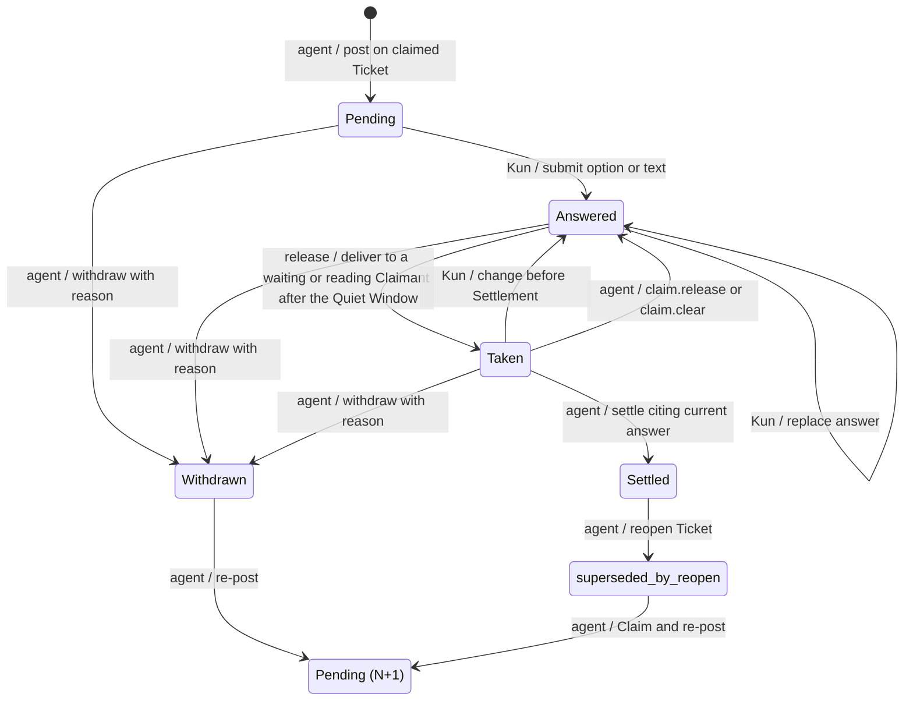
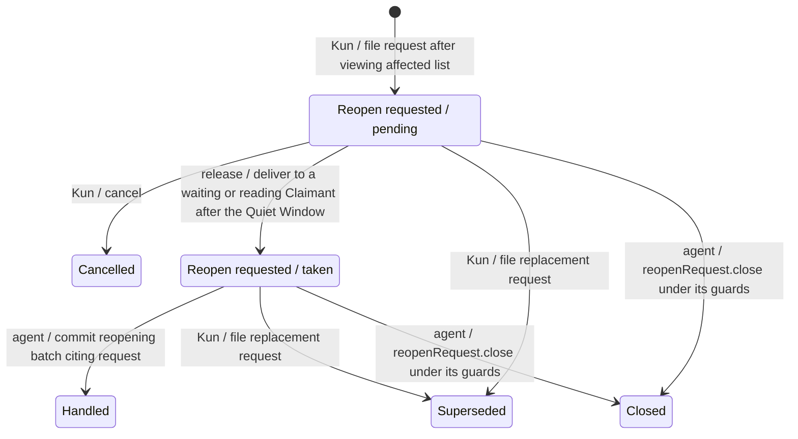

# Answer Desk

Status: accepted by Kun on 2026-10-26 for [#109](https://github.com/kun-g/wayfinder_map_service/issues/109), part of [#108](https://github.com/kun-g/wayfinder_map_service/issues/108). Issue closeout follows the [gate in section 10](#10-accepted-by-kun-on-2026-10-26). This describes the implementation contract, not a delivered capability.

The design session's defaults, including the review and re-review clarifications on storage, citations, reopening and public schemas, were accepted by Kun on 2026-10-26 and relayed through the implementation coordinator. This document is their single normative source; the viewer/MCP amendments and ADRs link here. Use [GLOSSARY.md](../../GLOSSARY.md), [M1](m1.md), [the local MCP contract](mcp-sqlite.md) and [the viewer contract](map-viewer.md) for unchanged behavior.

## 1. Outcome and boundary

Agents post every currently askable question to the Answer Desk on the local Map viewer and continue independent work. Kun considers them at his own pace; the service delivers his responses, and the agent settles the Decision Tickets.

The desk belongs to the existing Wayfinder service. Its target business interface is exactly `map_create`, `map_list`, `map_read`, `map_apply` and `map_wait`, with one keyed browser write entry for human responses. Map edits, question posting/withdrawal, Claims, reopening and Settlements remain MCP operations. Agents cannot submit or confirm Desk Answers through MCP. There is no embedded assistant, separate answer service, general graph editor, public listener, OAuth, sharing or MCP Apps delivery.

The Ticket's question remains only the question; recommendations live on the Desk Question and the accepted outcome lives in the Settlement. Desk delivery states neither replace the Ticket's open/settled lifecycle nor affect Frontier membership. An answer is not a Decision, Finding or Completion merely because it was submitted or Taken.

The two client spikes in #108 support the transport choice, not feature acceptance: Claude Code 2.1.310 resumed an idle session after a server-everything 2.0.1 HTTP task completed two minutes later; Codex 0.164.0 negotiated `2025-11-25` and completed a 90-second blocking call with `tool_timeout_sec = 300`. The decisions and alternatives are recorded in [ADR 0006](../adr/0006-answer-desk-in-the-map-viewer.md) and [ADR 0007](../adr/0007-map-wait-for-answer-delivery.md).

## 2. Questions and answers

Accepted fields:

| Desk Question field | Meaning |
| --- | --- |
| `questionId`, `ticketId`, `questionVersion` | Identify the request, its Decision Ticket within its Map and the exact published Question Version, distinct from a Map Revision or Release Version. |
| Options | Two or three choices, each with a label and one-line description; keyboard choices correspond to 1–3. |
| Recommended option and full recommended answer | Identify the recommendation and show the complete proposed answer on which Kun can give a verdict. |
| `whyKun` | Explain why this question needs Kun's judgment. |
| `triage`, with reason | `needsKun` or `followRecommendation`, with the agent's explanation of the classification. Both still require a human answer. |
| `gatesResearch` | Whether this answer decides if long research should be dispatched. |
| `postedAt` | Publication time used after the dependency and triage ordering keys. |

The view shows what the question unlocks from the current Dependencies, including both computed counts in section 5. Agents supply the triage reason and research flag; they do not store or invent unlock counts.

There is at most one active Desk Question per Decision Ticket: a publication displayed as Pending, Answered or Taken on an open Ticket. An agent posts it through `map_apply` only on a Ticket it claims, under the existing `expectedRevision` and Claim rules. Any change to its options, recommendation or meaning, including a typo correction, requires withdrawal with a reason followed by publication of version N+1. There are no in-place edits. An old publication and its answers remain inspectable; re-posting does not repurpose their identity.

A Desk Answer records its own identity, the Question Version it answers and the selected option or non-empty text. A changed answer supersedes the prior answer; retain both and identify the current one. Answers to older Question Versions are marked stale and are never released or settled. A submission for a question withdrawn since it was displayed is refused with “question changed, answer again”; never silently apply it to N+1.

## 3. State and transition ownership

Taken belongs to a Desk Answer or Reopen Request as its delivery state; a Desk Question's displayed state derives from its publication, current answer and Ticket Settlement. The diagrams separate that display from the request lifecycle; neither adds Ticket lifecycle states. `Pending (N+1)` is a new publication, not erasure of the previous one. Each edge has one owner: Kun, the agent, or the release coordinator shared by `map_wait` and taking `map_read`.



Changing a Taken answer before Settlement immediately voids the old answer and leaves the replacement Answered. A withdrawal has a nonblank reason; the viewer strikes through the question and shows that reason.

### Claim release and inheritance

Pending and Answered questions belong to the Ticket and remain when its Claim is released or cleared. The next Claimant inherits them and may withdraw/re-post. If an answer is Taken but unsettled, the agent's `claim.release` or `claim.clear` command returns it to Answered in the same transaction as that command's Revision. Disconnection alone does not release a Claim.

### Reopen Requests

The desk offers Reopen on every settled Ticket. Before Kun files a Reopen Request, it shows the settled dependent Tickets that the service computes M1 would require reopening. The request records that exact list as `affectedTickets`, along with the requested option or text. Filing authorizes reopening the target and the named dependents, applying the [workflow's human-agreement rule](../agents/exploration-mcp.md#resume-and-advance) at request time; it does not authorize unnamed dependents or supply a verdict on a replacement answer. An option may reference only the Desk Question behind the target's current Settlement; it records that publication's `questionId` and `questionVersion` as well as the option's index and label, using the schema in section 6.2. A Ticket settled without a Desk Answer, including a conversation or historical Settlement, offers text only. Kun may cancel after seeing the list until the request is Taken; the Ticket stays settled until explicit agent action and there is no agent rejection state.

The filing write carries the Settlement identities the page displayed: `settlementIntroducedAtRevision` is the target's displayed `introducedAtRevision`, and `affectedSettlementRevisions` is the full displayed map of affected Ticket IDs to their Settlement `introducedAtRevision` values, with exactly the keys in `affectedTickets`. In the filing transaction, the service compares the target binding and the entire affected set/bindings with its current computation. If any Ticket ID or Revision differs, including a target no longer settled, refuse with “the list changed, review again”; the page redisplays the current list with nothing filed or replaced. On success, record the verified displayed values; never silently substitute newer Settlements. Refusal follows the [failed-operation Quiet Window rule](#human-submission).

The first Claimant taking answers on the Map receives the request as a `reopen_request` item. A settled Ticket has no Claim and the original agent session may be gone, so requests are Map-scoped. Taking is once-only; the [current-read projection](#62-public-results-and-recovery-reads) provides recovery, and any Claimant on the Map may handle a Taken request without releasing it again.



`map_apply` gains optional `reopenRequestId`. The service accepts the citation only for a Taken, unhandled request on that Map whose recorded Settlement is still the target's current Settlement, checked before the batch reopens the target. A pending request cannot be cited, preserving Kun's cancellation window. Handling is not tied to the taking Claimant. The first committing batch marks the request handled and removes it from `reopenRequests`; a later citation is rejected as already handled. Its [handled-request context remains readable under section 6.2](#62-public-results-and-recovery-reads).

In the committing transaction, the service checks that the cited batch reopens the target under M1's existing reopen/Claim rules. The settled dependents it reopens must equal M1's currently required set, and each must be covered by the request: both listed in `affectedTickets` and still carrying its recorded Settlement before reopening. If the set shrank, reopen only the currently required dependents and mark the request handled. A newly required Ticket or a changed dependent Settlement rejects the whole batch with `reopen_authorization_exceeded`; its `uncoveredTickets: {ticketId, reason}[]` lists every uncovered Ticket ID and the reason `not_listed` or `settlement_changed`, respectively. The agent asks Kun first, naming them. There is no silent cascade or permission to reopen an obsolete recorded dependent merely because it was once listed. #111 chooses the other stable rejection codes under [M1's error conventions](m1.md#6-result-and-error-contracts), including pending, cross-Map, already-handled, closed/superseded or stale-target citations, an omitted target and a failed close guard.

An unusable request has two completion paths. Kun may file a new request for the same target after seeing the current affected list; the new request supersedes the older unhandled one. Alternatively, the agent uses `reopenRequest.close {requestId, reason}` for an unhandled request only when its target no longer has the recorded Settlement, checked after the batch's earlier commands. This covers a reopen in the same batch, an already-open target and a target settled again with a different introduction Revision. Closing is not rejection of Kun's request: the service checks loss of that Settlement, not an unobservable conversation agreement; an uncited reopen retains the [workflow's human-agreement rule](../agents/exploration-mcp.md#resume-and-advance), which M1 does not verify. A closed or superseded request leaves the recovery list and cannot be cited.

### Publication after reopening

Every reopen path closes the Ticket's settled Desk Question publication with state `superseded_by_reopen`: a Reopen Request target, each settled dependent reopened with it, and a Ticket reopened under a conversation agreement. All answers to that publication become stale and can never be cited again. The desk shows superseded publications and their answers as history, never as live answers.

A new Settlement of a reopened Ticket requires a new publication N+1 and a fresh Desk Answer cited through `deskAnswer`, or a conversation verdict while no question is active under the [Settlement rules](#agent-settlement). Reopened dependents get no preselection; the agent re-posts them as their turn comes.

Use the target's request context from [`FoundMap.reopenContexts` in section 6.2](#62-public-results-and-recovery-reads). For an option request, match each publication anew: exactly one option must match the source option's label and one-line description exactly to receive the [preselection marker](#human-submission); zero or multiple matches mean no marker. For a text request, show the text verbatim next to the options as “Kun asked to reopen: …” context, with no auto-selection or prefilled submission.

On each target re-post while the [request context in section 6.2](#62-public-results-and-recovery-reads) applies, the agent recommends Kun's requested option by default for an option request. If new facts lead it to recommend another option, `whyKun` must explain why.

## 4. Submission, release and Settlement

### Human submission

Selection submits immediately. Enter submits the recommendation, 1–3 submit the corresponding option, and `t` opens text entry. Opening, viewing and cancelling never submit; empty text never submits. Bulk confirmation applies only to selected `followRecommendation` questions and shows each full recommended answer before confirmation. It creates a separate answer to each displayed Question Version. A blanket “use recommendations” outside the desk remains insufficient.

Preselection, sourced from the [request context in section 6.2](#62-public-results-and-recovery-reads), is only a “Requested by Kun” marker, never drawn as a selected or submitted answer and never a submission itself. The page labels which option Enter submits. When the requested option and recommendation differ, show both markers distinctly, for example “Requested by Kun: 2 · Recommended: 1”; Kun uses the requested option's number key to submit it.

One Quiet Window belongs to the Map, across questions and Claimants. Each successful answer submission or change, or filing, replacing or cancelling a Reopen Request, restarts 15 seconds from that operation; failed operations do not. Editing several answers during that interval produces a batch containing only their latest valid versions. The service owns this timing; closing the page does not constitute either a verdict or a release. Expiry makes answers eligible for delivery, never for automatic Settlement.

### Agent delivery

The shared release coordinator delivers eligible answers only for the caller's currently claimed Tickets, plus Map-scoped Reopen Requests under section 3. All eligible items for that caller are delivered in one batch after the Map is quiet. Competing waiters cannot both take an item; only the explicit Claim-return transition above makes a previously Taken answer eligible again.

Commit Taken durably in an atomic release transaction just before writing a blocking or taking-read response, or before the first `tasks/get` that returns completed. An uncollected task does not take answers merely because the Quiet Window ended. Recheck each item's eligibility under sections 2–3 at delivery, including when a task result was prepared earlier. If the task's recheck finds nothing left, its completed result is `none_yet`. A network failure after the commit leaves the receipt unknown; writing a response is not proof that the client received it.

Taken survives disconnects, timeouts, cancellation and restarts. [Current reads](#62-public-results-and-recovery-reads) expose Taken-but-unsettled answers for recovery; neither a missing receipt nor a new wait auto-returns or settles them. Reopen Request recovery follows the same projection contract and the handling rules in section 3. A rejected stale Settlement must not consume the replacement answer.

### Agent Settlement

The `ticket.settle` command gains this additive, optional typed field alongside its existing fields:

```ts
deskAnswer?: { answerId: string; questionVersion: number };
```

It is mandatory when the Ticket has an active Desk Question. The citation must identify the current answer to the current Question Version, Taken by the settling Claimant; otherwise the service rejects the Settlement, including an answer never Taken. This is an explicit command field, not a custom Provenance field, Reference locator or Extensions convention. Retain the accepted citation with the Settlement record; M1's typed outcome, Evidence and Provenance remain unchanged. Validation and publication must prevent a concurrent answer change from producing an accepted stale Settlement.

Every displayed option is a proposed answer: its label and one-line description are what Kun saw and what the Settlement records. Selecting option 2 can therefore settle directly under the same checks as the recommendation; it needs no second question. Text is never auto-settled: the agent distinguishes a verdict on a displayed answer from a request for material. For the latter it withdraws with a reason, supplies the material and posts a new version. The Ticket's question remains unchanged, and no timer, task completion or lack of response settles anything.

For a conversation verdict while the Desk Question is Pending or Answered, the agent withdraws it in the same batch with reason `answered in conversation` and then settles without `deskAnswer`. A valid desk-backed Settlement closes its active question; any Settlement that would leave a question active is rejected. The agent cannot bypass the citation check by omitting it on an active question.

## 5. Queue ordering

The service derives ordering from the current Map; this display order does not change the M1 Frontier's ASCII Ticket-ID order. Compare these keys lexicographically:

1. Unlockers first: `immediateUnlocks > 0` **or** `gatesResearch` is true.
2. `immediateUnlocks` descending, then `downstreamUnsettled` descending.
3. `needsKun` before `followRecommendation`.
4. `postedAt` ascending, then question ID ascending.

`immediateUnlocks` is the Unlock Count: count dependents whose other prerequisites are already settled, so settling this Ticket alone would put them in the Frontier. `downstreamUnsettled` is the Downstream Count: all distinct unsettled direct or transitive dependents, counted once regardless of the number of paths. Neither count includes the question's own Ticket. Display the derived consequences and the agent's triage reason; `gatesResearch` promotes a question into the unlocker group but does not fabricate a Dependency.

For example, if B requires both A and another open Ticket, settling A alone does not count B as an immediate unlock, but B counts downstream. If B's other prerequisites are already settled, B counts as an immediate unlock. A shared descendant reached through two paths counts once. With zero immediate unlocks, a research-gating question ranks before a non-gating question even when the latter has more downstream Tickets.

## 6. Client paths and protocol state

| Client | Answer delivery |
| --- | --- |
| Claude Code | Opt into `io.modelcontextprotocol/tasks` on `map_wait` using the `2026-07-28` extension; task completion can resume the idle session. |
| Codex | Call `map_wait` as an ordinary blocking tool call only after independent work is exhausted; configure a long tool timeout in the dedicated launcher. |
| ChatGPT | Do not call `map_wait`; use current `map_read` with `claimantId` and `version` at each turn start; Kun tells it when he is done. |

### 6.1 Public inputs

These signatures extend [MCP/SQLite §4](mcp-sqlite.md#4-public-tool-inputs); IDs retain its validation and `version` is the Release Version, never `questionVersion`:

```ts
interface MapWaitArgs {
  readonly mapId: MapId;
  readonly claimantId: ClaimantId;
  readonly version: string;
  readonly maxWaitSeconds?: number;
}
type MapReadArgs =
  | { readonly mapId: MapId; readonly revision?: RevisionNumber }
  | { readonly mapId: MapId; readonly claimantId: ClaimantId;
      readonly version: string };
```

| `map_wait` execution | Default `maxWaitSeconds` | Accepted range |
| --- | --- | --- |
| Blocking | 600 | Positive integer 1–1,500 |
| Task | 28,800 (8 hours) | Positive integer 1–28,800 |

Reject out-of-range values as invalid params; never clamp. The dedicated Codex launcher uses `tool_timeout_sec = 1800`, above the blocking cap. The server uses the explicit input bound, not an assumption that it can inspect a client's timeout configuration; the blocking path sends progress notifications while waiting.

A taking `map_read` requires `claimantId` and `version` together and omits `revision`. Either field alone, or `claimantId` on a historical read, is invalid params. Plain current and historical reads never take. Under [ADR 0005](../adr/0005-writes-attest-the-rules-version.md), `map_wait` and taking reads attest the rules before release; a taking read's `version_mismatch` returns the rejection with no Map state, just like a write tool. In `toolsOnly` mode the `map_read` version parameter description names the release as the write tools do. Inspection remains version-free.

### 6.2 Public results and recovery reads

All tool results keep the once-only structured-content and error conventions of [MCP/SQLite §5–§6](mcp-sqlite.md#5-once-only-structured-results). An option is the 1-based index within its immutable Question Version, matching keys 1–3; the index must exist on that publication. Returned items echo its label for readability. `answeredAt`, `requestedAt` and `quietUntil` are service timestamps.

```ts
type DeskChoice = { option: 1 | 2 | 3; label: string } | { text: string };
type ReopenChoice =
  | { option: 1 | 2 | 3; label: string;
      questionId: string; questionVersion: number }
  | { text: string };
interface AnswerItem {
  readonly kind: 'answer';
  readonly answerId: string;
  readonly questionId: string;
  readonly questionVersion: number;
  readonly ticketId: TicketId;
  readonly choice: DeskChoice;
  readonly answeredAt: string;
}
interface ReopenItem {
  readonly kind: 'reopen_request';
  readonly requestId: string;
  readonly ticketId: TicketId;
  readonly settlementIntroducedAtRevision: RevisionNumber;
  readonly requested: ReopenChoice;
  readonly affectedTickets: readonly TicketId[];
  readonly affectedSettlementRevisions: Readonly<Record<TicketId, RevisionNumber>>;
  readonly requestedAt: string;
}
type DeliveryItem = AnswerItem | ReopenItem;
interface MapWaitResult {
  readonly outcome: 'delivered' | 'none_yet' | 'superseded' | 'interrupted';
  readonly items: readonly DeliveryItem[];
  readonly currentRevision: RevisionNumber;
  readonly quietUntil?: string;
}
interface ReadDelivery {
  readonly outcome: 'delivered' | 'none_yet';
  readonly items: readonly DeliveryItem[];
  readonly quietUntil?: string;
}
interface UnhandledReopenRequest {
  readonly requestId: string;
  readonly ticketId: TicketId;
  readonly settlementIntroducedAtRevision: RevisionNumber;
  readonly requested: ReopenChoice;
  readonly affectedTickets: readonly TicketId[];
  readonly affectedSettlementRevisions: Readonly<Record<TicketId, RevisionNumber>>;
  readonly requestedAt: string;
  readonly state: 'pending' | 'taken';
  readonly stale: boolean;
}
interface ReopenContext {
  readonly ticketId: TicketId;
  readonly requestId: string;
  readonly requested: ReopenChoice;
  readonly handledAtRevision: RevisionNumber;
}
```

`delivered` has the items taken by this operation. Other outcomes have empty `items`: `none_yet` means no eligible delivery, `superseded` means a newer wait replaced this one, and `interrupted` means the service is stopping and this call took nothing. A `none_yet` result includes `quietUntil` when the Quiet Window is still open. A taking read never waits for the window: inside it, the read returns `delivery.outcome = 'none_yet'` with `quietUntil`. `currentRevision` identifies the Map head observed for the wait result; release does not advance it.

`FoundMap` retains `kind`, `revision` and `frontier` and gains:

| Field | Presence and meaning |
| --- | --- |
| `deskQuestions` | Every successful read: question publications with the fields from section 2, `state` and `withdrawnReason` when withdrawn. Current reads use the displayed state from section 3 and include `currentAnswer` (an `AnswerItem`, or null if unanswered or the publication is superseded), including Taken for recovery where still applicable. Historical reads return publications as they stood at the selected Revision (`published`/`withdrawn`/`superseded_by_reopen`), omitting `currentAnswer` and all other desk-side state. Publication retirement follows [section 3](#publication-after-reopening). |
| `reopenRequests: UnhandledReopenRequest[]` | Current reads only, listing pending and Taken-but-unhandled requests; inspection alone never releases them. `stale` is true when the target no longer has the request's recorded Settlement, so the agent can close it under section 3. This derived marker neither changes delivery state nor closes the request automatically. |
| `reopenContexts: ReopenContext[]` | Current reads only, one entry for each open Ticket whose current reopen was caused by a handled Reopen Request and which has not settled since. This is the data source for the agent's default re-post recommendation and the desk's “Requested by Kun” marker and text context. |
| `delivery: ReadDelivery` | Taking current reads only, using the same item schema as `map_wait`; no separate `delivered[]` or duplicated `currentRevision`, because `FoundMap.revision` already supplies it. |

The `reopenContexts` projection is an accepted design detail confirmed by Kun on 2026-10-26. Record `handledAtRevision` on the handled request and associate it with the target's reopen in that Revision; only that target receives the context, using the request that caused this reopen, never the latest handled request on the Ticket. The entry remains across interruption before re-posting, publication of N+1, its withdrawal and later re-posts, until the Ticket settles again. A later reopen uses only its own request; reopened dependents do not inherit the target's context.

Historical reads omit `delivery`, `reopenRequests` and `reopenContexts`; they do not fabricate past answers from current desk records. These projections implement the Revision boundary in section 8.1.

### 6.3 Tasks, admission and shutdown

Requests opting into `io.modelcontextprotocol/tasks` receive a task; others use the blocking path. The service advertises task discovery and implements `tasks/get` and `tasks/cancel`; `tasks/update` returns an error because the wait has no input phase. Task `ttlMs` is the effective `maxWaitSeconds * 1000 + 600000` (ten extra minutes). There are no `notifications/tasks` or `subscriptions/listen`; the release boundary in section 4 therefore precedes the first completed `tasks/get`, not a pushed completion. Protocol task states are separate from desk display and delivery states.

At most one suspended wait exists per `(mapId, claimantId)`; a newer one supersedes the older, whose result is `superseded`. A suspended wait holds none of the four concurrent-call slots. Its release transaction needs a slot but, once the wait has been admitted, waits internally for one and never fails on slot contention; admission rejection applies only to new calls. Stop admitting waits during shutdown. A blocking wait returns `interrupted`; a task ends failed with `service stopping`.

Task cancellation makes the task cancelled and takes nothing. MCP `notifications/cancelled` stops a blocking wait, takes nothing new and returns no Taken answers; the call ends under MCP cancellation semantics, not with the service-stop outcome `interrupted`. Stop and cancellation complete promptly and do not undo earlier committed taking. If release committed just before cancellation arrived, the items remain Taken with an unknown receipt and are recovered through a current read, as with any lost response.

The task registry is shared across request-scoped server instances and may be process-wide memory. An unknown task ID after restart is an error; the agent recovers by reading or starting a new wait. Protocol task handles need not survive restart, unlike the SQLite records in section 8.2; this supersedes #112's original durable-task wording.

SDK v2 and the two protocol eras follow [MCP/SQLite §15.2](mcp-sqlite.md#152-sdk-v2-and-two-protocol-eras). [Section 14.3](mcp-sqlite.md#143-versioning-build-and-release) defines restart and rules-version protection: sessionless modern clients cannot be refreshed through the old session-404 path. The Inputs above apply that protection to delivery operations.

## 7. Keyed browser boundary

One browser key is unguessable, separate from and not derived from the MCP write token, and invalidated by service restart at the latest. It authorizes only answer submission/change, Reopen Requests and cancellation of untaken Reopen Requests. A local process without the key cannot answer. Only the key holder answers; the MCP credential does not confer this capability.

The `wayfinder` launcher opens the desk with `#key=…`; after reading it the page strips the fragment using `history.replaceState` and sends the key in a request header on the one write route. Never put it in a query, Map state, logs or error text. Issuance, page storage and rotation mechanics belong to #113 under these invariants.

Retain exact loopback Host and same-origin checks, unkeyed reads, non-caching responses, and GET/HEAD on all other viewer routes. Continue the two-second viewer polling cadence and unreachable/stale indication; it must surface desk-only changes even when the Map Revision is unchanged, so a `known=<revision>` comparison alone is insufficient for the desk. The test tunnel forwards only `/mcp`, never the desk. Verify light/dark rendering and 375 px without horizontal overflow against the existing viewer and the approved interaction design.

## 8. Revisions, storage and required evidence

### 8.1 Revision boundary and adapters

Map Revisions are created only by `map_create` and accepted agent `map_apply` batches, including posting/withdrawing questions, Settlements, Claim commands and closing Reopen Requests. Kun's answers and changes, filing/replacing/cancelling Reopen Requests, and taking items leave `currentRevision` unchanged. Mutable desk records are not embedded in Map snapshots, and a human answer alone cannot make the agent's next `expectedRevision` stale. Read projections follow [section 6.2](#62-public-results-and-recovery-reads).

A valid `reopenRequest.close` counts as a change for [M1's no-net-change check](m1.md#5-pure-preparation-and-invariant-stages), amending MCP/SQLite §6's treatment of net no-ops. A batch containing only valid closes commits one Revision instead of returning `no_changes`, even though its Map graph content is unchanged. That Revision's `changes` records each close with its command index, command `reopenRequest.close`, request ID as `subjectId`, and reason. Closing and publishing the Revision are atomic; an invalid or repeated close still rejects under the command guards. Historical reads can inspect these changes without embedding mutable Reopen Request records.

Keep StateAdapter's three operations: `readCurrent`, `readRevision` and `commit`. Extend the command union with post-question, withdraw-question and `reopenRequest.close`; the typed Settlement citation is specified in section 4 and request handling in section 3. Browser/release writes to answers, Taken and Reopen Requests remain outside StateAdapter. Agent question-publication/Claim/Settlement/reopen commands and request handling or closing commit their desk effects atomically with their Revision; immutable earlier Revisions remain unchanged.

### 8.2 Format 2 and startup migration

`FORMAT_VERSION = 2` adds SQLite tables for Desk Questions, Desk Answers and Reopen Requests, retaining their versions, supersession and delivery state. This explicitly amends MCP/SQLite §8's initial-format/no-migration rule and §9's two-table representation, without expanding StateAdapter.

On startup, migrate an existing format-1 database one way: first complete a consistent backup to `<db>.pre-format-2.<UTC timestamp>.<nonce>.sqlite` in the same private database directory, through the existing backup mechanism and its permission rules; refuse an existing destination. Then apply one migration transaction and publish format 2. The service never deletes this backup; removing it is a manual operator choice. If backup or migration fails, do not admit calls against a partly migrated database; transaction failure leaves format 1 intact. Fresh initialization creates format 2 directly. Recognized format-2 databases open normally; refuse an unknown newer format. There is no downgrade. Preserve the existing private-path, permission, backup-destination and failure rules; this authorizes no other repair, reset or automatic migration.

### 8.3 Required evidence

The service enforces key scope, Question Version matching, supersession, release ownership, once-only delivery and Settlement validity. The agent supplies triage judgment, decides whether free text is a verdict and explains affected decisions. This separates deterministic guards from judgment without making the human relay answers between clients.

| Scenario | Required observation |
| --- | --- |
| Publish and replace | Claim and expectedRevision checks apply; only one active question; changing any publication withdraws with a reason and creates N+1; old answers remain stale and cannot settle. |
| Submit and bulk confirm | Opening/cancelling/empty text write no answer; option selection submits; each bulk answer refers to a recommendation actually displayed. |
| Quiet Window | An answer submission/change or Reopen Request filing/replacement/cancellation on the same Map restarts the window; failures do not; only latest valid answers are released after 15 seconds; timeout never settles. |
| Competing waiters | Only one release takes an answer; ordinary answers match the caller's claimed Tickets; Map-scoped Reopen Requests go to only one claimant; a newer same-scope wait supersedes the earlier one. |
| Edit versus settle | Changing Taken to Answered invalidates the old answer; both race orders are checked and an obsolete answer cannot win after the replacement is accepted. |
| Requested material | Agent withdraws, supplies the material and re-posts; the request for material itself is never a Settlement. |
| Reopen publication | Request targets, reopened settled dependents and conversation reopens all retire the old publication; every old answer becomes stale and cannot settle again. |
| Reopen preselection | Only the request that caused the target's reopen supplies context; reordered identical options mark the new index, while changed or ambiguous matches mark none. The marker is never a selected/submitted answer; Enter submits the visibly labelled recommendation, and a different requested option remains available through its number key. Using the [section 6.2 context](#62-public-results-and-recovery-reads), the agent defaults to the requested option or explains its different recommendation in `whyKun`; reopened dependents have no preselection. |
| Reopen context recovery | Interrupt the agent after handling a Reopen Request and before re-posting, then resume: a current read still exposes the requested option in `reopenContexts` under [section 6.2](#62-public-results-and-recovery-reads), and the agent recommends it. Historical reads omit the field. |
| Re-post continuity | Withdraw N+1 and publish N+2: retain the same reopen's request context, rematch option labels/descriptions and show text verbatim without prefilled submission. A later Settlement ends that context; another reopen cannot inherit the old request. |
| Reopen request source | The displayed dependent list and Settlement bindings equal the stored authorization. Between display and filing, change the target Settlement, one dependent Settlement or the affected IDs; each filing is refused, nothing is filed/replaced, the page redisplays the current list, and the Quiet Window does not restart. Option requests identify their source publication; conversation/historical Settlements support text-only requests; recovery follows [section 6.2](#62-public-results-and-recovery-reads). |
| Reopen citation | Pending or cross-Map citations and a batch omitting the target are rejected without handling the request; a Taken request can be handled by a different Claimant on the Map; the first committed batch handles it and an already-handled citation is rejected. A request filed against an earlier Settlement cannot reopen a newer Settlement, including when the old pending request is delivered after the target is settled again; current reads mark that request stale. |
| Changed affected set or Settlement | A shrunk set reopens exactly the currently required dependents and handles the request; growth or a listed dependent settled again rejects the whole batch with `reopen_authorization_exceeded`. The error lists every uncovered Ticket with `not_listed` or `settlement_changed`, even when the required Ticket IDs themselves have not changed. |
| Reopen supersession and close | A new request for the same target shows the current list and supersedes the old unhandled request; close rejects while the recorded Settlement is current and succeeds after an earlier reopen command, on an open target, or after a new Settlement replaces it. Exercise both an uncited conversation reopen and a reopen as another request's dependent; closed/superseded requests leave recovery and are uncitable. A close-only batch commits one Revision with every request ID and reason in its changes, never `no_changes`; a repeated close rejects and publishes nothing. |
| Loss and restart | Durable answer/Taken state survives; lost response is an unknown receipt; no automatic return or Settlement; resumption discovers unprocessed Taken answers. |
| Claim release/clear | Pending/Answered questions survive; Taken returns in the same transaction as the Claim Revision; the next Claimant inherits the question. |
| Queue | Verify already-settled versus still-open other prerequisites, shared descendants, research gating, triage and stable tie-breakers. |
| HTTP and versions | Keyless or cross-origin answers fail; other viewer routes stay read-only; both MCP eras work and old Release Versions cannot write, wait or take through a read; ordinary/history reads never take. |
| Admission and shutdown | Suspended waits leave ordinary slots available and release uses a slot atomically; task and blocking cancellation before release take nothing; cancellation racing after release preserves Taken for read recovery; stop and cancellation complete promptly. |
| Client journeys | Claude task wake-up, Codex blocking completion and ChatGPT turn-start delivery are tested on the actual implemented service with isolated data. |
| Revision boundary | Compare head/history around every browser and release transition; only agent MCP writes advance it, so an answer does not cause expectedRevision conflict. |
| Migration | A fresh database starts at format 2; the private backup completes before the one format-1-to-2 transaction and is never automatically deleted; failure preserves the old format; existing backup targets, unknown newer formats and downgrade are refused. |
| Settlement citation | Missing, stale, superseded, never-Taken and wrong-Claimant citations fail; option 2 succeeds; a conversation verdict requires withdrawal in the same batch and leaves no orphan question. |

Tests for this implementation must control submission and release boundaries rather than rely on sleeps to choose a race winner. Existing Map history, expectedRevision, Claim, typed Settlement and conflict rules remain regression gates. These are future acceptance obligations; the documentation PR's build/test/typecheck run does not claim to exercise them.

## 9. Implementation and release sequence

Until #114, the desk is disabled by default; #111–#113 ship behind one service setting that tests and isolated runs enable, and #114 enables it by default.

| Issue | Delivery |
| --- | --- |
| #109 | This specification, two ADRs, glossary and contract amendments; closeout follows [section 10](#10-accepted-by-kun-on-2026-10-26). |
| #110 | SDK v2 and both protocol eras; retain four tools, schemas and workflow at this step; record actual SDK/client/protocol connectivity evidence. Connectivity evidence includes an automated test that replays ChatGPT App 26.1016's recorded `server/discover` request (the body pinned in `tests/helpers/chatgpt-discovery.ts` and exercised in `tests/behaviour/chatgpt/chatgpt.test.ts`, #126) under the `toolsOnly` credential, followed by a sessionless `tools/list` and one write `tools/call`: discovery returns a schema-valid `2026-07-28` result, the four tools carry the `toolsOnly` version descriptions, and a write with the wrong `version` is rejected as before. Live ChatGPT on the modern era is checked at the #114 run, the one ChatGPT run; #110 adds no ChatGPT run. |
| #111 | Format-2 desk storage and migration, including Reopen Requests, Settlement bindings and affected-dependent computation; post/withdraw commands, typed Settlement citations, `reopenRequestId` validation and handled marking, `reopenRequest.close`, publication retirement, preselection/history data and the [section 6.2 inspection read projection](#62-public-results-and-recovery-reads). |
| #112 | `map_wait` and ChatGPT taking `map_read` through one release coordinator, including `reopen_request` delivery, task/blocking paths, recovery and exact-tool-set/build metadata. |
| #113 | Viewer write route for answer submit/change, Reopen Requests displaying the affected list and cancellation; preselection/text context and superseded publications shown as history; keyed, keyboard/bulk and visual behavior. |
| #114 | Publish all-askable posting, unlock-first triage and client use in the mandatory workflow and every governed tool description, plus launcher instructions and behavior scenarios. |

#112 depends on #110 and #111; #113 depends on #111; #114 depends on #112 and #113. This assignment replaces #113's original submit-answer-only wording; this specification governs later additions even when the implementation Issue bodies have not yet been synchronized. Follow those Issues for scheduling and Kun's gates. Do not ship the discarded intermediate chat-only approach. Agents settle released verdicts and post newly unlocked questions in the same write where the existing command rules allow it.

Under [MCP/SQLite §14.3](mcp-sqlite.md#143-versioning-build-and-release), this documentation-only PR keeps the Release Version and adds no CHANGELOG section or tag. The current workflow file and generated guidance remain unchanged. The additive implementation Issues specify minor releases; the mandatory workflow change ships with the desk as one later major release after #87, with one approved ChatGPT run before that merge. No real-model Batch, ChatGPT run, everyday-service operation or release is authorized by this specification PR. Keep `Refs #109` for the [closeout gate](#10-accepted-by-kun-on-2026-10-26).

## 10. Accepted by Kun on 2026-10-26

The accepted design defaults are recorded in sections 2–9, including the review and re-review clarifications. No additional product decision is proposed here. The remaining #109 gate is the design session's check that this text faithfully records those decisions, independently of the build result; only then does the coordinator close #109 and #110–#114 start. Any new design choice discovered during that check returns to Kun rather than inheriting this verdict.
