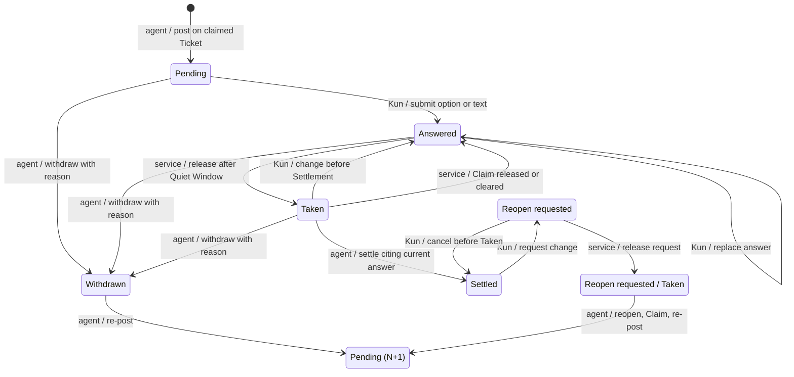

# Answer Desk

Status: decisions accepted by Kun on 2026-10-26 for [#109](https://github.com/kun-g/wayfinder_map_service/issues/109), part of [#108](https://github.com/kun-g/wayfinder_map_service/issues/108). The design session still checks this consolidated specification against those decisions before the coordinator closes #109 and #110–#114 start. This describes the implementation contract, not a delivered capability.

The Answer Desk design session supplied two batches of details through the implementation coordinator, including six clarifications and decisions A–D on read delivery, Reopen Requests, task lifetime and admission. Kun accepted all of them on 2026-10-26; the coordinator relayed that verdict before this specification's closeout. Section 10 records the accepted points and the remaining transcription check. Use [GLOSSARY.md](../../GLOSSARY.md), [M1](m1.md), [the local MCP contract](mcp-sqlite.md) and [the viewer contract](map-viewer.md) for unchanged behavior.

## 1. Outcome and boundary

Agents post every currently askable question to the Answer Desk on the local Map viewer and continue independent work. Kun considers those questions at his own pace. Selecting an option submits it; after 15 seconds without a submission on that Map, the service can release the answers to agents. Only the agent settles a Decision Ticket.

The desk belongs to the existing Wayfinder service. It adds one keyed browser write entry for human responses and one MCP business tool, `map_wait`, for agents to receive them. Questions hang on claimed Decision Tickets. Map edits, question posting/withdrawal, Claims, reopening and Settlements remain MCP operations. Agents cannot submit or confirm Desk Answers through MCP. There is no embedded assistant, separate answer service, general graph editor, public listener, OAuth, sharing or MCP Apps delivery.

The Ticket's question remains only the question; recommendations live on the Desk Question and the accepted outcome lives in the Settlement. Desk delivery states neither replace the Ticket's open/settled lifecycle nor affect Frontier membership. An answer is not a Decision, Finding or Completion merely because it was submitted or Taken.

The two client spikes in #108 support the transport choice, not feature acceptance: Claude Code 2.1.310 resumed an idle session after a server-everything 2.0.1 HTTP task completed two minutes later; Codex 0.164.0 negotiated `2025-11-25` and completed a 90-second blocking call with `tool_timeout_sec = 300`. The decisions and alternatives are recorded in [ADR 0006](../adr/0006-answer-desk-in-the-map-viewer.md) and [ADR 0007](../adr/0007-map-wait-for-answer-delivery.md).

## 2. Questions and answers

Accepted fields:

| Desk Question field | Meaning |
| --- | --- |
| Question identity, `ticketId`, `version` | Identify the request, its Decision Ticket within its Map and the exact published Question Version. This version is neither a Map Revision nor the Release Version. |
| Options | Two or three choices, each with a label and one-line description; keyboard choices correspond to 1–3. |
| Recommended option and full recommended answer | Identify the recommendation and show the complete proposed answer on which Kun can give a verdict. |
| `whyKun` | Explain why this question needs Kun's judgment. |
| `triage`, with reason | `needsKun` or `followRecommendation`, with the agent's explanation of the classification. Both still require a human answer. |
| `gatesResearch` | Whether this answer decides if long research should be dispatched. |
| `postedAt` | Publication time used after the dependency and triage ordering keys. |

The view shows what the question unlocks from the current Dependencies, including both computed counts in section 5. Agents supply the triage reason and research flag; they do not store or invent unlock counts.

There is at most one active Desk Question per Decision Ticket. An agent posts it through `map_apply` only on a Ticket it claims, under the existing `expectedRevision` and Claim rules. Any change to its options, recommendation or meaning, including a typo correction, requires withdrawal with a reason followed by publication of version N+1. There are no in-place edits. An old publication and its answers remain inspectable; re-posting does not repurpose their identity.

A Desk Answer records its own identity, the Question Version it answers and the selected option or non-empty text. A changed answer supersedes the prior answer; retain both and identify the current one. Answers to older Question Versions are marked stale and are never released or settled. A submission for a question withdrawn since it was displayed is refused with “question changed, answer again”; never silently apply it to N+1.

## 3. State and transition ownership

The diagram describes one question publication. `Pending (N+1)` represents a new publication, not erasure of the previous record. Every edge has one owner: Kun, agent, or the service release coordinator used by `map_wait` and the ChatGPT read path. The service also performs the specified return of unsettled answers when a Claim is released or cleared.

`Reopen requested / Taken` is the Reopen Request's delivery marker, not a new Ticket lifecycle state. Reopen Requests belong to the Map: the first Claimant taking answers on that Map receives the request, typed as `reopen-request`. A settled Ticket has no Claim and its original agent session may be gone, so delivery is not restricted to a current Claim or the original poster. Repeated waits do not deliver the request to another Claimant after it is Taken.

| State or transition | Required meaning and guard |
| --- | --- |
| Pending | Published question awaiting a human response; viewing it gives no verdict. |
| Answered | Human response stored; the latest response is eligible for release only after the Quiet Window. |
| Taken | Released for processing; this is not proof of Settlement or of client receipt. Repeated waits do not release that answer again. |
| Taken → Answered by Kun | A change before Settlement immediately voids the previously Taken answer; the replacement starts a new Quiet Window. |
| Taken → Answered by service | An explicit Claim release or clear returns an unsettled Taken answer for the next Claimant; disconnect, cancellation, timeout and restart do not. |
| Taken → Settled | Agent supplies a valid typed Settlement citing the current answer identity and Question Version. |
| Withdrawn | Agent records a nonblank reason; the viewer strikes through the withdrawn question and displays that reason. |
| Reopen requested | Kun instructs the agent to change a settled answer; the Ticket remains settled until the agent explicitly reopens it. There is no agent rejection state. |

Kun may cancel a Reopen Request until it is Taken. Once Taken, the agent handles it under the existing reopen rules, claims the Ticket and re-posts as N+1; the request is agreement to reopen, not itself a new verdict. The re-posted question names any affected settled downstream decisions and the desk preselects the option Kun requested without submitting it. Kun confirms that option with a key press before it can settle. M1 still requires explicit reopening of affected settled dependents and explicit treatment of blocking Claims in a valid atomic batch; there is no silent cascade. Choosing the original answer on the new publication permits a new Settlement only after that new verdict.

## 4. Submission, release and Settlement

### Human submission

Selection submits immediately. Enter submits the recommendation, 1–3 submit the corresponding option, and `t` opens text entry. Opening, viewing and cancelling never submit; empty text never submits. Bulk confirmation applies only to selected `followRecommendation` questions and shows each full recommended answer before confirmation. It creates a separate answer to each displayed Question Version. A blanket “use recommendations” outside the desk remains insufficient.

One Quiet Window belongs to the Map, across questions and Claimants. Each successful new or changed submission restarts 15 seconds from the latest submission; a failed submission is not an answer. Editing several answers during that interval produces a batch containing only their latest valid versions. The service owns this timing; closing the page does not constitute either a verdict or a release. Expiry makes answers eligible for delivery, never for automatic Settlement.

### Agent delivery

`map_wait` identifies `mapId` and `claimantId`, carries the Release Version `version` like `map_apply`, and returns eligible answers only for that Claimant's currently claimed Tickets, plus Map-scoped Reopen Requests as specified in section 3. All eligible answers for that caller are delivered in one batch after the Map is quiet. An answer or request is released once; competing waiters cannot both take it.

Commit Taken durably in an atomic release transaction just before writing the blocking response, or before the first `tasks/get` that returns completed. An uncollected task does not take answers merely by reaching the end of the Quiet Window. Recheck the current answer, Question Version and applicable Claim at delivery, including when a task result was prepared earlier. A task that never completed released nothing and leaves answers Answered. A network failure after the commit leaves the receipt unknown to the client; writing a response is not proof that the client received it.

Taken answers survive disconnects, timeouts, cancellation and restarts. Current reads expose Taken-but-unsettled answers so a resumed agent can recover them; neither loss of a receipt nor a new wait auto-returns or settles them. Claim release/clear is the explicit exception in the state diagram. A rejected stale Settlement must not consume the replacement answer.

### Agent Settlement

The agent checks whether the answer is a verdict on the actual proposed answer and settles with the Ticket's question unchanged. Settlement provenance identifies the desk, answer identity and Question Version. The service rejects an answer-backed Settlement citing a superseded, stale or otherwise invalid answer even if the agent previously received it. Validation and publication must prevent a concurrent change to that answer from producing an accepted stale Settlement.

Text is never auto-settled. A text answer requesting material is not a verdict: the agent withdraws the question with a reason, supplies the material and posts a new version. Text that actually gives a verdict on the shown recommendation can support Settlement after the same checks. No timer, task completion or lack of response settles anything.

## 5. Queue ordering

The service derives ordering from the current Map; this display order does not change the M1 Frontier's ASCII Ticket-ID order. Compare these keys lexicographically:

1. Unlockers first: `immediateUnlocks > 0` **or** `gatesResearch` is true.
2. `immediateUnlocks` descending, then `downstreamUnsettled` descending.
3. `needsKun` before `followRecommendation`.
4. `postedAt` ascending, then question ID ascending.

`immediateUnlocks` is the Unlock Count: count Tickets that would enter the Frontier if this Ticket alone settled, with all other prerequisites already settled and each counted Ticket open and unclaimed. `downstreamUnsettled` is the Downstream Count: all distinct unsettled direct or transitive dependents, counted once regardless of the number of paths. Neither count includes the question's own Ticket. Display the derived consequences and the agent's triage reason; `gatesResearch` promotes a question into the unlocker group but does not fabricate a Dependency.

For example, if B requires both A and another open Ticket, settling A alone does not count B as an immediate unlock, but B counts downstream. A shared descendant reached through two paths counts once. A claimed dependent does not enter the Frontier and therefore is not an immediate unlock. With zero immediate unlocks, a research-gating question ranks before a non-gating question even when the latter has more downstream Tickets.

## 6. Client paths and protocol state

| Client | Answer delivery |
| --- | --- |
| Claude Code | Opt into `io.modelcontextprotocol/tasks` on `map_wait` using the `2026-07-28` extension; task completion can resume the idle session. |
| Codex | Call `map_wait` as an ordinary blocking tool call only after independent work is exhausted; configure a long tool timeout in the dedicated launcher. |
| ChatGPT | Do not call `map_wait`; use current `map_read` with `claimantId` and `version` at each turn start after Kun tells it he is done. The read path releases eligible answers for the Claimant without waiting. |

The blocking path sends progress notifications and returns answers or “none yet” before the caller's timeout. A timeout returns no invented verdict. A requested long timeout such as 1,800 seconds is launcher configuration, not permission to block shutdown indefinitely. At most one suspended wait exists per `(mapId, claimantId)`; a newer wait supersedes the older one, which returns “superseded”. A suspended wait does not hold one of the four concurrent tool-call slots; the atomic release transaction does. Cancellation and service stop return promptly without settling or returning Taken answers.

`map_read` gains optional `claimantId`, which requires `version` with it. Only a current read with both can take eligible answers. A read without them or an explicit historical read never takes anything; it can still show questions and answers. Read inspection remains version-free, while taking attests the rules exactly like `map_wait`. A historical read never becomes a delivery operation merely because it includes a Claimant.

SDK v2 serves both protocol eras on `/mcp`. The service implements the Tasks extension's discovery capability, `tasks/get` and `tasks/cancel`; it does not treat SDK v1's deprecated experimental task API as the new extension. Task cancellation concerns delivery, not a Question withdrawal, Claim release or Settlement. Protocol task states are independent of the six desk states.

Questions, answers, supersession, Question Versions and Taken state persist in SQLite. The task registry must survive fresh server instances for each modern request, but may be process-wide memory; after restart an unknown task ID is an explicit error and the agent reads authoritative state or starts a new wait. The design session clarified that this supersedes #112's original durable-task wording: protocol task handles need not survive restart. Persisting task handles is not a substitute for durable answers.

Modern `2026-07-28` clients have no MCP session or `mcp-session-id`; the historical restart-404/reinitialize path cannot reach them. A restart does not prove that a model learned new instructions. `map_create`, `map_apply`, `map_wait` and a taking `map_read` require explicit Release Version attestation under [ADR 0005](../adr/0005-writes-attest-the-rules-version.md); old-version calls fail before mutation or taking answers. Inspection reads remain ungated because they change no state. See [MCP/SQLite §14.3 and §15](mcp-sqlite.md#143-versioning-build-and-release).

## 7. Keyed browser boundary

One browser key is unguessable, separate from and not derived from the MCP write token, and invalidated by service restart at the latest. It authorizes only answer submission/change, Reopen Requests and cancellation of untaken Reopen Requests. A local process without the key cannot answer. Only the key holder answers; the MCP credential does not confer this capability.

The `wayfinder` launcher opens the desk with `#key=…`; the page sends the key in a request header on the one write route. Never put it in a query, Map state, logs or error text. The fragment avoids HTTP transmission but is not a guarantee against browser history by itself. Issuance, page storage and rotation mechanics belong to #113 under these invariants.

Retain exact loopback Host and same-origin checks, unkeyed reads, non-caching responses, and GET/HEAD on all other viewer routes. Continue the two-second viewer polling cadence and unreachable/stale indication. The test tunnel forwards only `/mcp`, never the desk. Verify light/dark rendering and 375 px without horizontal overflow against the existing viewer and the approved interaction design.

## 8. Enforcement and required evidence

The service enforces key scope, Question Version matching, supersession, release ownership, once-only delivery and Settlement validity. The agent supplies triage judgment, decides whether free text is a verdict and explains affected decisions. This separates deterministic guards from judgment without making the human relay answers between clients.

| Scenario | Required observation |
| --- | --- |
| Publish and replace | Claim and expectedRevision checks apply; only one active question; changing any publication withdraws with a reason and creates N+1; old answers remain stale and cannot settle. |
| Submit and bulk confirm | Opening/cancelling/empty text write no answer; option selection submits; each bulk answer refers to a recommendation actually displayed. |
| Quiet Window | A submission on another question of the same Map restarts the window; only latest valid answers are released after 15 seconds; timeout never settles. |
| Competing waiters | Only one release takes an answer; ordinary answers match the caller's claimed Tickets; Map-scoped Reopen Requests go to only one claimant; a newer same-scope wait supersedes the earlier one. |
| Edit versus settle | Changing Taken to Answered invalidates the old answer; both race orders are checked and an obsolete answer cannot win after the replacement is accepted. |
| Requested material | Agent withdraws, supplies the material and re-posts; the request for material itself is never a Settlement. |
| Reopen | Request preserves the old Settlement until agent action; cancellation before Taken returns to Settled; affected dependents follow M1's explicit reopen rules. |
| Loss and restart | Durable answer/Taken state survives; lost response is an unknown receipt; no automatic return or Settlement; resumption discovers unprocessed Taken answers. |
| Claim release/clear | Unsettled Taken answers return to Answered and become eligible for a later Claimant; a client disconnect alone does not do this. |
| Queue | Verify AND prerequisites, claimed/settled exclusions, shared descendants, research gating, triage and stable tie-breakers. |
| HTTP and versions | Keyless or cross-origin answers fail; other viewer routes stay read-only; both MCP eras work and old Release Versions cannot write, wait or take through a read; ordinary/history reads never take. |
| Admission and shutdown | Suspended waits leave ordinary slots available, release uses a slot atomically, and cancellation/stop completes promptly without losing answers. |
| Client journeys | Claude task wake-up, Codex blocking completion and ChatGPT turn-start delivery are tested on the actual implemented service with isolated data. |

Tests for this implementation must control submission and release boundaries rather than rely on sleeps to choose a race winner. Existing Map history, expectedRevision, Claim, typed Settlement and conflict rules remain regression gates. These are future acceptance obligations; the documentation PR's build/test/typecheck run does not claim to exercise them.

## 9. Implementation and release sequence

| Issue | Delivery |
| --- | --- |
| #109 | This specification, two ADRs, glossary and contract amendments; Kun accepted the decisions on 2026-10-26, and the design session checks the transcription before closeout. |
| #110 | SDK v2 and both protocol eras; retain four tools, schemas and workflow at this step; record actual SDK/client/protocol connectivity evidence. |
| #111 | Durable Desk Question/answer storage and existing-tool commands/read projection, preserving Ticket question and Settlement semantics. |
| #112 | Fifth tool, task/blocking delivery, concurrency and recovery checks; update the exact-tool-set build gate and local tool description. |
| #113 | Keyed answer mode in the viewer, keyboard/bulk interaction and visual acceptance. |
| #114 | Publish all-askable posting, unlock-first triage and client use in the mandatory workflow and every governed tool description, plus launcher instructions and behavior scenarios. |

#112 depends on #110 and #111; #113 depends on #111; #114 depends on #112 and #113. Follow the implementation Issues for scheduling and Kun's gates. Do not ship the discarded intermediate chat-only approach. Agents settle released verdicts and post newly unlocked questions in the same write where the existing command rules allow it.

Under [MCP/SQLite §14.3](mcp-sqlite.md#143-versioning-build-and-release), this documentation-only PR keeps the Release Version and adds no CHANGELOG section or tag. The current workflow file and generated guidance remain unchanged. The additive implementation Issues specify minor releases; the mandatory workflow change ships with the desk as one later major release after #87, with one approved ChatGPT run before that merge. No real-model Batch, ChatGPT run, everyday-service operation or release is authorized by this specification PR. Keep `Refs #109`; the coordinator closes the Issue after the design session verifies the specification against Kun's decisions, independently of the build result.

## 10. Accepted decisions and closeout

Kun accepted all the following points on 2026-10-26:

- One active publication, immutable Question Versions, current-answer Settlement checks and withdraw/re-post handling of requests for material.
- A Map-wide 15-second Quiet Window, changes after Taken and explicit return to Answered on Claim release/clear.
- Ordering by immediate unlocks or research gating, then immediate and downstream counts, triage, post time and question ID.
- Current `map_read` taking only with both `claimantId` and `version`, with ordinary and historical reads remaining inspections.
- Map-scoped Reopen Requests, cancellation only before Taken and explicit reopen/Claim/re-post followed by a new human verdict.
- A process-wide task registry with durable questions/answers/Taken, once-only release and unknown-receipt recovery after interruption.
- One suspended wait per Map/Claimant, superseding older waits, free ordinary slots while suspended and prompt cancellation/stop.
- A separate browser answer key and distinct specification, implementation and major-workflow release gates.

No additional product decision is proposed here. The remaining #109 gate is the design session's check that this text faithfully records the accepted decisions; any new design choice discovered during that check returns to Kun rather than inheriting this verdict.
